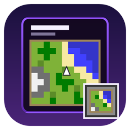

<p align="center"></p>

# Map Preview (Horizon native mod)

See what's on a map without holding it. Hover a filled map and its picture shows in the tooltip; every map in your
hotbar, inventory and chests shows a small copy of its picture instead of the plain map icon, so you can tell them
apart at a glance.

Client side only: it works in single player and on any server.

## Settings

Options > Mods > Map Preview > Settings. Each button steps through its values.

| Setting | Values | Default |
|---|---|---|
| Tooltip preview | OFF, Always, Hold Shift | Always |
| Tooltip size | Small (64), Medium (96), Large (128 GUI pixels) | Medium |
| Tooltip background | OFF, Paper, Map background | Map background |
| Slot preview | OFF, ON | ON |
| Slot style | Full slot, Border, As map item | As map item |
| Slot resolution | Pixelated, High | High |
| Locked map glass | OFF, ON | ON |
| Reset to defaults | | |

## Good to know

- Maps show their preview as soon as your game knows what's drawn on them. Any map you've held in
  your inventory or seen displayed in an item frame will show its preview right away. If you ever 
  find a map in a chest without a preview, simply pick it up once to load its picture.
- Maps update live: explore with a map and its preview fills in.
- In "As map item" mode, the map frame automatically matches the resolution of your active resource pack (16×16, 32×32, or 64×64).
- Locked maps show a Bedrock-style glass sheen in inventory slots when "Locked map glass" is enabled, but this isn't tied to the resolution of your resource pack.

## Install

In the Horizon launcher: Mods, find **Map Preview**, Install, then **Build**. To try a local copy, put the `.hnmod` in
your instance's `horizon-native-mods/` folder and Build.

## Compatibility

Tested on Horizon Nightly `fdc87ae` (2026-11-08), hook API 411, horizon-mixins `5a64af9`.

Horizon has no hook point that gives a mod a map's pixels, so besides hook points this mod reads the game's own maps
(`Game.maps` and `maps::map_id` in `crates/horizon-client/src/game/maps.rs`) and Horizon's map palette
(`horizon_client::blocks::MAP_COLORS`). If a later Horizon changes those, this mod needs an update for it.

## How it works

| File | What it is |
|---|---|
| `mixins/map_preview/horizon-mixin.toml` | The bundle: one module and its HEAD hooks |
| `mixins/map_preview/runtime.rs` | The settings, map colours, picture runs as rectangles and rotated quads, and frame/overlay pixel data; also this crate's library, for its tests |
| `measure.rs`, `draw.rs` | The tooltip picture (`native_tooltip_component` and `native_tooltip_component_draw`) |
| `slot.rs` | The slot picture (`native_item_decorations`) |
| `key.rs` | Follows Shift, for "Hold Shift" |
| `list.rs`, `settings.rs`, `click.rs` | The Options > Mods page |

Pictures are drawn as filled rectangles or rotated quadrilaterals, one per run of same-coloured pixels in a row. The mod only reads map data the
client already has; it has no network, file or process access beyond Horizon's own settings files for the mod.

```sh
cargo test    # colours, picture layout and settings
```

## Credits

Inspired by [Map Tooltip](https://modrinth.com/mod/map-tooltip) by VendoAU and
[Map In Slot](https://modrinth.com/mod/map-in-slot) by Crec0. Map Preview is written from scratch for Horizon and
contains none of their code or assets; it is not made or endorsed by them.

Item map overlays and rotation rendering layout designed and contributed by [FitchWorks](https://github.com/FitchWorks).

Map overlay/framing assets are inspired by vanilla Minecraft by Mojang Studios and adapted from [Faithful](https://faithfulpack.net) by the Faithful Team under the [Faithful Project License](https://faithfulpack.net/license).

## License

MIT, see [LICENSE](LICENSE).
