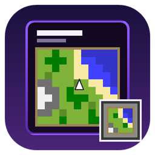

<p align="center"></p>

# Map Preview (Horizon mod)

See what's on a map without holding it. Hover a filled map and its picture shows in the tooltip; every map in your
hotbar, inventory and chests shows a small copy of its picture instead of the plain map icon, so you can tell them
apart at a glance.

Client side only: it works in single player and on any server.

## Settings

Options > Mods > Map Preview > **Config**. Each button steps through its values.

| Setting | Values | Default |
|---|---|---|
| Tooltip preview | OFF, Always, Hold Shift | Always |
| Tooltip size | Small (64), Medium (96), Large (128 GUI pixels) | Medium |
| Tooltip background | OFF, Paper, Map background | Map background |
| Slot preview | OFF, ON | ON |
| Slot style | Full slot, Border, As map item | As map item |
| Slot resolution | Pixelated, High | High |
| Locked map glass | OFF, ON | ON |

## Good to know

- A preview needs the map's picture on your client. The server sends it for maps you carry (as vanilla does), so
  your own maps always show. A map you have never carried, in a chest on a server, may show no preview until you
  pick it up once.
- Maps update live: explore with a map and its preview fills in.
- In "As map item" mode, the map cutout frame is derived at runtime from your active resource pack's `item/map` and
  `item/filled_map` textures, so it automatically adapts to any resource pack and resolution.
- Locked maps draw a glass rim and upper-left streak derived at runtime from your active resource pack's `block/glass`
  texture when "Locked map glass" is enabled.

## Install

Made for Horizon **Nightly 2026-11-21 · f037744**.
It patches the game, so it builds only on that exact Horizon build: if the launcher lists it as
**Left out**, switch your instance to that Nightly, or wait for the version made for yours.

From GitHub:

1. Download `map_preview-2.0.4.hmod` from the [latest release](https://github.com/selfmonoraque5/map-preview/releases/latest).
2. Put it in the `horizon-native-mods` folder of your game folder, not in `mods`. On Windows that is
   `%APPDATA%\horizon\horizon-native-mods`.
3. In the launcher, open the Mods page and click **Build** (the first build downloads the mod SDK and takes a few
   minutes). After a build the launcher can look stuck for a while as it cleans its cache: let it finish.
4. When it says **Up to date**, play.

Once it is listed in the Horizon registry: Mods, find **Map Preview**, Install.

To build a local copy: `horizon-launcher native-build <this folder> --instance <instance> --trust-native-code`.

Map Preview 2.0 is made for Horizon's mod API, so its settings start from the defaults again once: the 1.x settings
files aren't read.

## Compatibility

The tooltip and slot pictures come from a Part on the filled map item (`tooltip_component`,
`tooltip_component_draw`, `item_decorations`). The mod API doesn't show a client mod a map's pixels, so the mod also
patches one game function (`[[native.mixin]]` in `horizon-mod.toml`): a HEAD on `game/interface/play_input.rs`
`input_hud_begin`, which each frame hands over the pictures of the maps being drawn (`Game.maps`), Horizon's map
palette and the textures the frame and glass are cut from. It works on the Horizon build it is made for; a later
Horizon that changes those needs an update.

## How it works

| File | What it is |
|---|---|
| `horizon-mod.toml` | The manifest: id, version, the Horizon build it is made for, and the game patch |
| `src/lib.rs` | The settings page, and the filled map's Part: tooltip space and picture, slot picture and count |
| `src/preview.rs` | The settings, map colours, picture runs as rectangles and rotated quads, and the frame and glass cut from the resource pack's textures, with their tests |
| `src/mixins/maps.rs` | The game patch: the maps' pictures, the palette and the textures |
| `assets/map_preview/lang/en_us.json` | The settings page's text |

Pictures are drawn as filled rectangles or rotated quadrilaterals, one per run of same-coloured pixels in a row. A
map shows its preview from the frame after it is first drawn. The mod only reads map data the client already has; it
has no network, file or process access beyond Horizon's own settings for the mod.

```sh
cargo test    # colours, picture layout, the frame and glass, and settings
```

## Credits

Inspired by [Map Tooltip](https://modrinth.com/mod/map-tooltip) by VendoAU and
[Map In Slot](https://modrinth.com/mod/map-in-slot) by Crec0. Map Preview is written from scratch for Horizon and
contains none of their code or assets; it is not made or endorsed by them.

Item map overlays and rotation rendering layout designed and contributed by [FitchWorks](https://github.com/FitchWorks).

## License

MIT, see [LICENSE](LICENSE).
